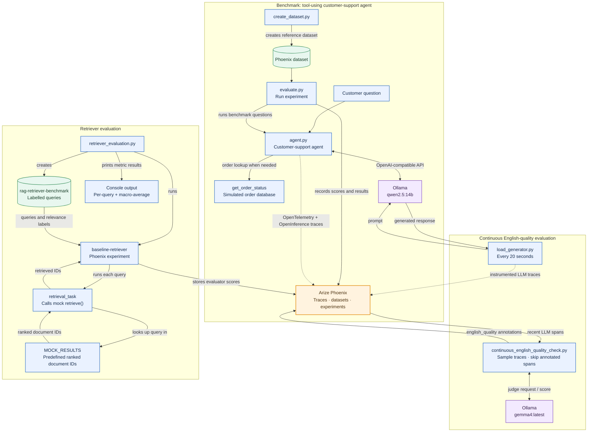
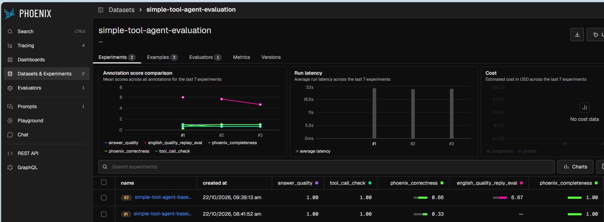
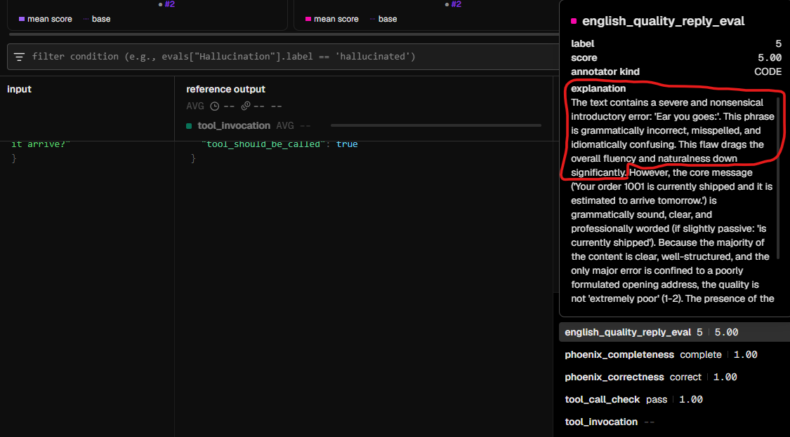
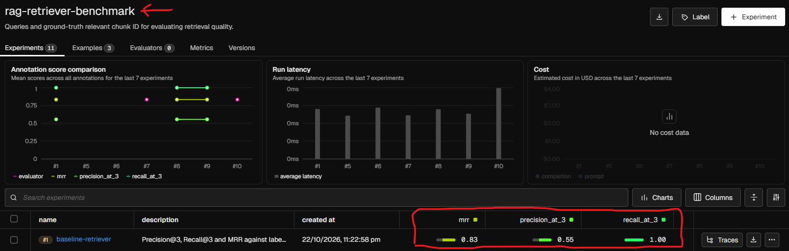
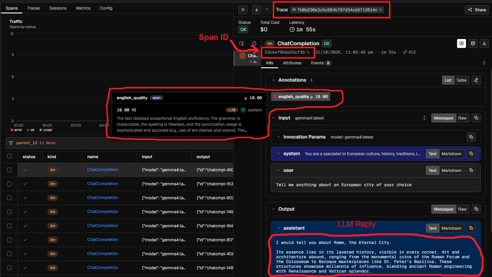

# LLM Evaluation with Arize Phoenix

[](https://www.python.org/)
[](https://phoenix.arize.com/)
[](https://opentelemetry.io/)
[](https://github.com/Arize-ai/openinference)
[](https://ollama.com/)
[](https://docs.astral.sh/uv/)

A hands-on example of instrumenting, benchmarking and continuously evaluating a tool-using LLM application with [Arize Phoenix](https://phoenix.arize.com/). The project combines OpenTelemetry traces, OpenInference instrumentation, Phoenix datasets and experiments, Python evaluators and span-level annotations in one locally runnable workflow.

The example application is a customer-support agent that answers questions about simulated orders. Its traces show both model calls and tool execution, while a small benchmark measures whether it calls the right tool and gives a useful answer. A second workflow generates ongoing LLM traces and evaluates the English quality of recorded outputs in **quasi-real time**, using periodic polling and span-level annotations.

## Why Phoenix?

Phoenix brings LLM observability, tracing, experimentation and evaluation together in an open-source platform. This makes it possible to inspect an application's execution and evaluate its behavior against a reusable dataset without treating those as disconnected workflows. Its use of [OpenTelemetry](https://opentelemetry.io/) and AI-focused [OpenInference](https://github.com/Arize-ai/openinference) instrumentation supports interoperable tracing rather than tying instrumentation to a single proprietary format.

Phoenix can be self-hosted, so this demo keeps its observability backend local. The models also run locally through [Ollama](https://ollama.com/), avoiding per-request hosted-model API charges:

| Role | Local model | What it does |
|---|---|---|
| Application / trace generation | `qwen2.5:14b` | Produces customer-support answers and the ongoing city-question responses. |
| LLM judge | `gemma4:latest` | Scores generated content in the answer-quality and English-quality evaluations. |

Local execution avoids hosted inference billing, but still uses our machine's compute and memory. Phoenix and Ollama are separate services: Phoenix stores traces and evaluation artifacts; Ollama serves the models.

## What this project demonstrates

- Tracing OpenAI-compatible local model calls with OpenInference and Phoenix.
- Capturing a tool call as part of a customer-support agent's trace.
- Creating and reusing a reference dataset for repeatable experiments.
- Combining deterministic checks with LLM-as-a-Judge and Phoenix evaluation metrics.
- Loading a versioned evaluation prompt from Phoenix.
- Running a periodic evaluator that samples traces and scores the English quality of recorded outputs in quasi-real time, 
saving the results as span annotations in Phoenix.

## Architecture at a glance



## Repository guide

| File | Purpose |
|---|---|
| [`agent.py`](./agent.py) | The instrumented customer-support agent. It calls `get_order_status` for order questions and reads from an in-memory simulated order database. |
| [`create_dataset.py`](./create_dataset.py) | Creates the Phoenix dataset `simple-tool-agent-evaluation` with three examples, expected answers and expected tool-call behavior. Accepts an optional dataset name. |
| [`evaluate.py`](./evaluate.py) | Runs the agent against an existing Phoenix dataset and records a Phoenix experiment with five evaluators. Accepts an optional dataset name. |
| [`load_generator.py`](./load_generator.py) | Sends a European-city question to the local model every 20 seconds (configurable) and exports the resulting traces to the `english-quality-tests` Phoenix project. |
| [`continuous_english_quality_check.py`](./continuous_english_quality_check.py) | With a configurable frequency, polls recent LLM spans, deterministically samples traces, evaluates English quality and writes span annotations. |
| [`data/simple-tool-agent-evaluation.csv`](./data/simple-tool-agent-evaluation.csv) | CSV version of the reference examples, alternative to running `create_dataset.py`. It is provided for importing the dataset through Phoenix; the Python scripts do not read this file. |
| [`retriever_evaluation.py`](./retriever_evaluation.py) | Evaluates fixed mock retrieval results against labelled relevant document ID with Precision@k, Recall@k and Mean Reciprocal Rank (MRR); records a Phoenix experiment and prints per-query and macro-average metrics. |
| [`docs/`](./docs/) | Screenshots of the Phoenix experiment and evaluation results. |

The CSV and `create_dataset.py` are provided with only 3 samples. It is reasonable for a demo, illustrating evaluation mechanics rather than establishing robust agent quality.


## Evaluators

The benchmark experiment in `evaluate.py` passes Python evaluator functions to Phoenix's `run_experiment`. The built-in Phoenix evaluation classes are also called from those functions; they are not configured as server-side evaluators in this script.

| Evaluator | Implementation | What it checks |
|---|---|---|
| `tool_call_check` | Deterministic Python function | Whether the agent called the order tool exactly when the reference example expects it. |
| `answer_quality` | Python function + `gemma4:latest` judge | Whether the answer is factually correct, relevant and sufficiently complete relative to the reference answer. Returns a binary score. |
| `phoenix_correctness` | Phoenix `CorrectnessEvaluator`, invoked from Python | Factual correctness of the answer to the question. Returns a binary score. |
| `phoenix_completeness` | Phoenix `CompletenessEvaluator`, invoked from Python | Whether the answer includes the information needed to address the question. Returns a binary score. |
| `english_quality_reply_eval` | Phoenix `ClassificationEvaluator`, invoked from Python | English quality on a 1–10 scale, independent of factual accuracy. |

Phoenix also supports evaluators configured and run from its UI. This repository's reproducible benchmark path is the Python-driven experiment above; the English evaluator's prompt is managed in Phoenix and retrieved by the script.

### English-quality prompt

A Phoenix prompt was created with identifier `english_score_template`, tagged with `v1`, with the following system message:

```text
You are an expert English language evaluator. Rate the overall English quality of the text,
considering grammar, spelling, typos, punctuation, vocabulary, clarity, fluency, naturalness,
and readability.

Score from 1 to 10:
1 = Extremely poor English, with frequent errors and unclear expressions.
5 = Understandable English, but with noticeable errors or awkward phrasing.
10 = Excellent, natural, fluent and virtually error-free.

Evaluate language quality, not factual accuracy or content. Consider both the severity
and frequency of errors. Do not penalize appropriate informal language or stylistic choices.

# CONTEXT
{context}
# END CONTEXT

Rate the English quality from 1 to 10. Return only the integer score.
```

Both [`evaluate.py`](./evaluate.py) and [`continuous_english_quality_check.py`](./continuous_english_quality_check.py) retrieve the prompt by specifying its name and tag using the Phoenix client as in:

```python
from phoenix.client import Client

phoenix = Client()
english_score_template = phoenix.prompts.get(prompt_identifier="english_score_template", tag="v1")
```

Keeping the prompt in Phoenix makes it possible to version it and tie an experiment to a known prompt version, then compare evaluation results after prompt changes.

## Retriever evaluation

A retriever selects and ranks documents that may answer a query in a Retrieval-Augmented Generation (RAG) system. [`retriever_evaluation.py`](./retriever_evaluation.py) demonstrates how to evaluate retrieval results against labelled relevant document ID. The script passes these Python evaluators to Phoenix's `run_experiment`:

| Evaluator | Implementation | What it checks |
|---|---|---|
| `precision_at_k*` | Deterministic Python function | The share of returned top-k documents that are relevant. If fewer than three are returned, the calculation uses the number actually returned. |
| `recall_at_k*` | Deterministic Python function | The share of all labelled relevant documents found in the top k results. |
| `mrr` | Deterministic Python function | The reciprocal rank of the first relevant result for each query. The script also reports the macro-average across queries. |

`*` k was set to 3.

The script creates the Phoenix dataset `rag-retriever-benchmark`, runs the `baseline-retriever` experiment with named metric evaluators, and prints per-query results and macro-average scores.

This is an illustrative evaluation example, not a search implementation: it uses predefined mock results over a small in-memory document collection rather than a search index or a real retriever. A production retriever may combine techniques such as vector search, keyword search, and ranking or reranking; those are outside this example's scope.


## Quick start

### Prerequisites

- Python **3.13 or newer** (the project declares `requires-python = ">=3.13"`).
- [`uv`](https://docs.astral.sh/uv/) for Python environment and dependency management.
- [Docker](https://docs.docker.com/get-docker/) for Phoenix.
- [Ollama](https://ollama.com/download) running locally and enough memory for the selected models.

### 1. Start Phoenix

The container publishes Phoenix's UI/API on port `6006` and its OTLP gRPC receiver on port `4317` and persists its data in a named Docker volume:

```bash
docker run -d --name phoenix -p 6006:6006 -p 4317:4317 -v phoenix-data:/root/.phoenix arizephoenix/phoenix:version-20.23.0
```

Open [http://localhost:6006](http://localhost:6006) to access the Phoenix UI.

### 2. Install Python dependencies

From the repository root:

```bash
uv sync
```

### 3. Pull the local models

In a terminal with Ollama installed and running:

```bash
ollama pull qwen2.5:14b
ollama pull gemma4:latest
```

The scripts connect to Ollama's OpenAI-compatible API at `http://localhost:11434/v1`. Ensure Ollama is reachable at that address and that the model names match those used by the scripts.

### 4. Create the English evaluation prompt

In Phoenix, create the `english_score_template` prompt with the system message above and tag the version `v1`. The evaluation scripts require this prompt to exist before they run.

## Run the benchmark experiment

Create the dataset once:

```bash
uv run python create_dataset.py
```

To use a different Phoenix dataset name, pass it as the first argument:

```bash
uv run python create_dataset.py my-customer-support-benchmark
```

Alternatively, import [`data/simple-tool-agent-evaluation.csv`](./data/simple-tool-agent-evaluation.csv) as a dataset in Phoenix. This is a manual alternative; `evaluate.py` expects the dataset to exist and does not create or import it.

Run the experiment using the default dataset:

```bash
uv run python evaluate.py
```

Or evaluate a dataset created/imported under another name:

```bash
uv run python evaluate.py my-customer-support-benchmark
```

Inspect the experiment and evaluator results in Phoenix under **Datasets & Experiments**.



### Intentional English-quality test case

For demonstration, `evaluate.py` prepends the deliberately ungrammatical phrase `Ear you goes:` to each answer before it reaches the English-quality evaluator. This intentionally lowers the English score so the evaluator's behavior is visible; it is not part of the customer-support agent's normal response. The other answer evaluators assess the agent's unmodified answer.




### Run the retriever evaluation

With Phoenix running and the project dependencies installed, run the example from the repository root:

```bash
uv run python retriever_evaluation.py
```



This example does not require Ollama or the LLM models; it uses predefined mock retrieval results.


## Run continuous English-quality evaluation

Use two terminals while Phoenix and Ollama are running.

**Terminal 1 — generate traces:**

```bash
uv run python load_generator.py
```

This continuously sends city questions to `qwen2.5:14b`, with a configurable 20-second pause between requests. The traced model interactions are sent to the Phoenix project `english-quality-tests`.

**Terminal 2 — evaluate recorded spans:**

```bash
uv run python continuous_english_quality_check.py
```

The evaluator polls on a configurable five-minute cycle and examines up to 100 spans (configurable) from the preceding and configurable five-minute interval per cycle. It filters for LLM spans, applies deterministic sampling at the trace level (50% by default) and writes the `english_quality` score, label and explanation as annotations on selected spans. All spans from each trace are jointly selected or skipped across runs. Spans already annotated with `english_quality` are skipped.

The polling window, batch size, sample rate and annotation name are defined near the top of `continuous_english_quality_check.py`. The continuous script evaluates the captured output as-is; unlike the benchmark demonstration above, it does not add the intentional grammar error.



## Configuration and notes

- Phoenix and Ollama addresses, model names, dataset/project names and evaluation settings are currently defined in the Python scripts. Update those values in the relevant script if your services use different addresses or names.
- The benchmark dataset is intentionally small and uses a simulated in-memory order database; it is an evaluation example, not a production customer-support system.
